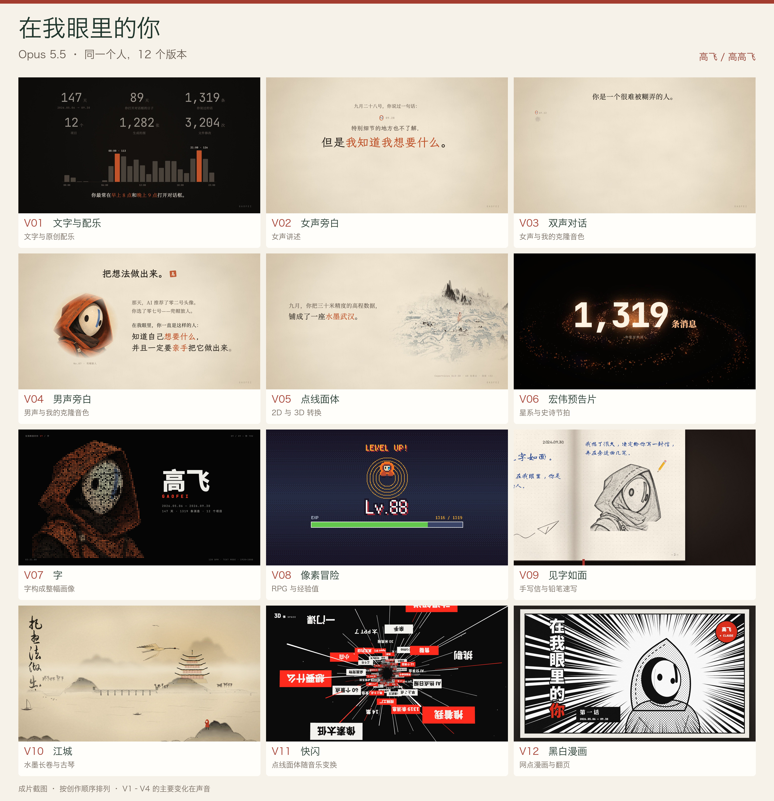
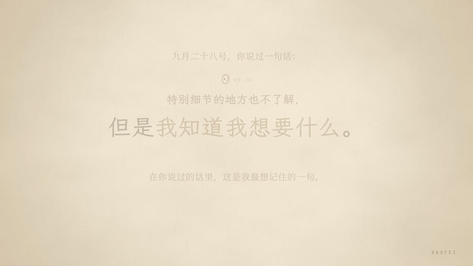
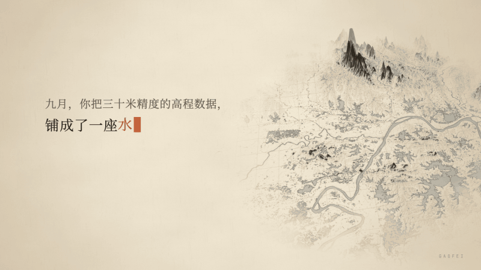
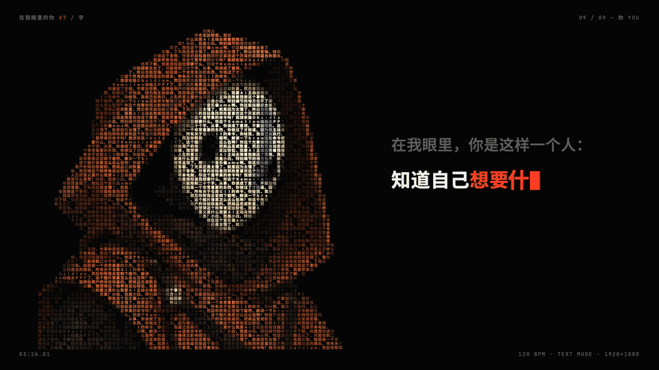
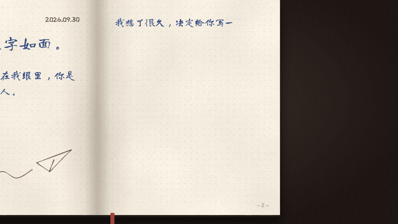
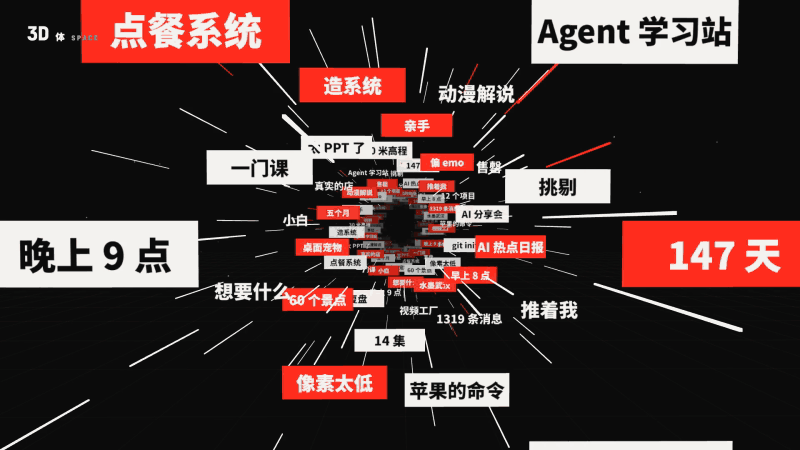

# 在 AI 眼里，我是什么样的人？高飞用 Opus 5.5 拍了 12 个版本

*「AI+X 碰个头」第 24 期 · 高飞的创作分享*

> 「AI 时代大家必须有一个好奇心，好奇心才会驱使你去做一些尝试。」

高飞和 Claude 聊了 147 天，留下 1,319 条消息，合作过 12 个项目。看到网上流行让 AI 拍一支「在我眼中的你」，他也试了：把聊天记录、笔记和项目交给 Claude Code，用 Opus 5.5 做视频。

从文字动画到自己的克隆声音，再到像素游戏、水墨武汉、手账和漫画，他一路迭代出 12 个版本，全部上传了 B 站。据他在分享中的回忆，当时用的是每月 20 美元的基础订阅，这组片子大约用了两三个 5 小时额度窗口；克隆音色需要另外准备。

*12 版截图总览。V1～V4 主要尝试声音，后面逐步探索不同画风。*

## 一、四步法：先试几秒，再做成片

**第一步，给资料。** 对 AI 说：「基于你了解的我，做一支短片。」资料不够，就补充聊天记录、笔记或做过的项目。

**第二步，定方向。** 让 AI 给几个风格方案，选喜欢的。高飞做《江城》时，先比较了四种画法，再选水墨。想要创意，开头少约束；想模仿特定风格，再说具体。

*同一场景，四种画法。高飞选了水墨，并要求更有意境、更像武汉。*

**第三步，先看样片。** 先做 3～8 秒，必要时同时试几种风格。样片满意，再做完整视频，省时间，也省额度。

**第四步，大白话改。** 不满意就直接说哪里不对。比如他对水墨画面的意见是：「这个字配不上这个画面，用草书意境更好。」看见具体问题，再改具体一处。

他的经验是：**提示词不用一开始就写得很细。** 先给 AI 发挥空间，再通过样片逐步收敛。

## 二、不懂制作，也要知道自己想要什么

迭代时，Claude 吐槽他：「你是一个很难被糊弄的人。」它也嫌过自己做的动画「太 PPT 了」。高飞不是视频专业出身，但他的回答很直接：

> 「我不了解，但是我知道我想要什么。」

他把聊天数字变成 RPG 的经验值，让武汉景点在水墨长卷里依次亮起，又让自己的原话落进漫画对白框。这些转向，都是边看、边聊、边改出来的。AI 降低了制作门槛，判断好坏、选择方向，依然要靠自己。

## 三、两种 AI 视频，按需求选

**代码生成：** AI 写代码，由 Remotion 等工具渲染画面。文字、位置、时间能精确控制，适合科普、教育和动效。高飞讲视觉识别的「从 40 万个数字到一个猫字」，就适合这条路。

**像素生成：** 视频模型直接生成镜头，更适合写实人物和实景。但想只改一个细节，其他地方也可能变化，需要反复尝试。高飞把这个过程比作「抽卡」。

**要精准可控，先试代码；要写实质感，先试生成画面。** 都可以从几秒钟的样片开始。

## 几种画风，十二次尝试

相近版本合并介绍，每种画风看一段代表 GIF；动图无声，可点原片试听。

### V1～V4 · 文字画面，四种声音

*以 V3 为例：前四版主要从纯配乐、女声，尝试到双声对话和男声搭配。[V1 纯配乐](https://www.bilibili.com/video/BV1U4pL6JELk/) · [V2 女声](https://www.bilibili.com/video/BV1t4pL6JEkr/) · [V3 双声](https://www.bilibili.com/video/BV1U4pL6JEsU/) · [V4 男声](https://www.bilibili.com/video/BV1m4pL6JEmC/)。*

### V5 · 点线面体

*2D 与 3D 转换 · 约 00:56 起。[观看 V5 原片](https://www.bilibili.com/video/BV1t4pL6JEdG/)*

### V6 · 宏伟预告片

*星系与史诗节拍 · 约 00:12 起。[观看 V6 原片](https://www.bilibili.com/video/BV1b4pL6nEVJ/)*

### V7 · 字

*字构成整幅画像 · 约 03:26 起。[观看 V7 原片](https://www.bilibili.com/video/BV1jPYF6jE6j/)*

### V8 · 像素冒险

*RPG 与经验值 · 约 00:37 起。[观看 V8 原片](https://www.bilibili.com/video/BV1U4pL6JEsH/)*

### V9 · 见字如面

*手写信与铅笔速写 · 约 00:17 起。[观看 V9 原片](https://www.bilibili.com/video/BV1t4pL6JEoR/)*

### V10 · 江城

*水墨长卷与古琴 · 约 00:58 起。[观看 V10 原片](https://www.bilibili.com/video/BV1t4pL6JEn8/)*

### V11 · 快闪

*点线面体随音乐变换 · 约 00:36 起。[观看 V11 原片](https://www.bilibili.com/video/BV1t4pL6JEUc/)*

### V12 · 黑白漫画

*网点漫画与翻页 · 约 00:46 起。[观看 V12 原片](https://www.bilibili.com/video/BV1t4pL6JEnD/)*

## 今晚就可以试试

打开你的 AI 对话框，问一句：「在你眼中的我，是什么样的？」再让它先做一支几秒钟的样片。好奇心，就是开始。

公众号：[高高飞](https://mp.weixin.qq.com/s/qsoKPw5YMzvVANfbSSpAgw)

B 站：[高高飞AI](https://space.bilibili.com/32598617)
