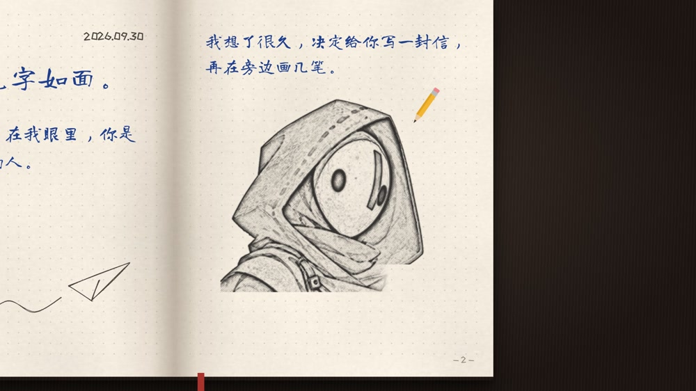
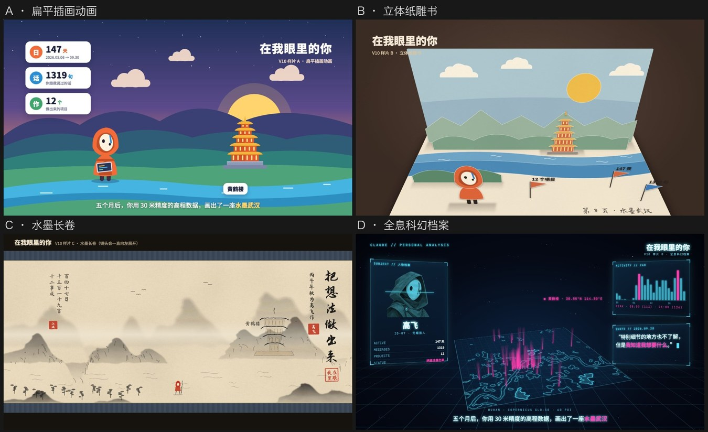
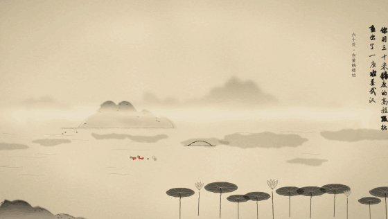
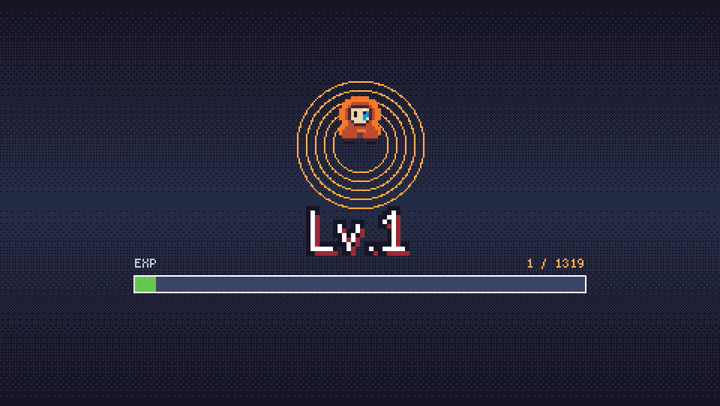
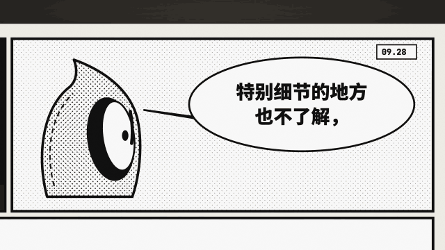

# 在 AI 眼里，我是什么样的人？高飞用 Opus 5.5 拍了 12 个版本

*「AI+X 碰个头」第 24 期 · 高飞的创作分享*

翻开一本手账，蓝色圆珠笔写下「高飞：见字如面。」镜头移向右页，一支铅笔慢慢勾出一个戴兜帽的小人。女声负责读信，念到高飞说过的话，声音就换成了他自己的。

*第 9 版《见字如面》，00:22。点开[有声原片](https://www.bilibili.com/video/BV1t4pL6JEoR/)，可以听见写信的人和收信的人。*

这封信起于一个好奇心。高飞在推特上看到有人让 AI 根据过去的对话，拍一支「在我眼里的你」。他也想知道：如果把自己过去 147 天留下的 1,319 条消息、笔记和 12 个项目交给 Claude，它会挑哪句话来讲他？

于是他在 Claude Code 里用 Opus 5.5 做了第一版：屏幕上只有字，耳边只有配乐。看完想听听加上人声会怎样；听到自己的声音，又想看看能不能把这几个月画成一场游戏。就这么一路做到了第 12 版。前面的 12 个项目是素材，后面的 12 支短片，是同一道题的 12 个答案。

这次分享里，他也报了自己的用量：当时用的是每月 20 美元的基础订阅，做这组片子，大约用了两三个 5 小时额度窗口。这是他对订阅用量的回忆；要复刻双声版，克隆音色还要单独准备。

## 一、四步走：先让它选，再说你喜欢什么

**第一步，把问题和资料一起给它。** 高飞让 Claude Code 读取自己选好的记录、笔记和项目，只提一个问题：「在你的视角里，我是一个什么样的人？」时长、画面、声音，都交给它。第一次尝试的人也不用先攒五个月：挑一段印象深的对话、一句你真的说过的话，再放一个做过的作品，就有了一个短镜头的材料。

**第二步，只定大方向。** 到了第 10 版，他没有直接点名要水墨，而是先请 AI 用同一个场景试四种画法。把四张图排在一起，问题就从「你想要什么风格」变成了「你愿意在哪一张里多待几秒」。

*第 10 版定稿前的四张候选样片。高飞选了左下角，又补了一句：要更有意境，元素要更像武汉。*

**第三步，只看 3 到 8 秒。** 静帧能选画风，动起来才能看出节奏。比如《江城》里，代表武汉景点的 60 个红点从黄鹤楼开始，沿着水岸依次亮起。看几秒，就能判断眼睛跟不跟得上那些点，字和画有没有互相抢位置。值得接着看，再做整条。

*第 10 版《江城》「百湖」段，约 00:59 起。成片拿掉了人声，只留古琴、箫和江上的动静。*

**第四步，用大白话改眼前这一处。** 看完水墨样片，高飞觉得字不对，说的是：「这个字配不上这个画面，用草书意境更好。」两套字摆在同一幅画上，比写一页「高级感」的定义管用。他的经验是：想看意外的东西，开头少设限制；已经看出了哪里别扭，就把那一处说具体。

## 二、AI 为什么说他「很难被糊弄」？

第 8 版《像素冒险》里，高飞第一次打开对话框，是一个 Lv.1 的新手。那 1,319 条消息成了经验值，147 天里真正有对话的 89 天，成了升级的刻度。后来连「PPT 动画」「读错的多音字」都成了游戏里的敌人，高飞用自己的原话反击，一下打出 9999 暴击。

*第 8 版《像素冒险》，约 00:37 起。同样一组聊天数字，这回能看着它往上长。*

Claude 在片子里说他：「你是一个很难被糊弄的人。」它自己也嫌过第一版动画「太 PPT 了」。高飞倒没有因此去学一套导演术语。分享里他讲得直接：「我不了解，但是我知道我想要什么。」

到第 12 版，这句话有了一个只有漫画才给得出的停顿。先是一格里，主角承认有些细节自己也不懂；镜头移过去，下一格才砸出红字：「但是，我知道我想要什么。」这一版干脆没有旁白。两格之间留多久，就决定了这句话怎么被读到。

*第 12 版《黑白漫画》，约 00:46 起。黑底框里是 AI 的旁白，气泡里是高飞的原话。*

## 三、做下一支片，什么时候写代码，什么时候生成画面？

高飞讲了另一个例子：要解释计算机怎么把「40 万个数字」认成一个「猫」字，观众得看清哪些数字在变、它们怎么汇到一起。这里他会选**代码生成**。让 AI 写出画面和运动的规则，由 Remotion 逐帧渲染。数字、位置、时间都能指定；某一步太快，就把这一步多留半秒。《江城》的红点和《像素冒险》的经验条，也是这么来的。

反过来，如果你最想要的是演员转头时脸上的光、一条雨后像实拍的街，他会先试**像素生成**，让视频模型直接生成镜头。它擅长给出这样的质感，代价是下次生成时，别的细节也可能一起变。高飞把反复试到满意比作「抽卡」。

选哪条路，可以先问自己：**如果只许改这一处，其他地方必须原样保留吗？** 如果答案是「必须」，先试代码；如果最在意的是一个镜头看上去像真的，先试生成画面。两条路都可以拿同一段几秒钟的样片来判断。高飞也用同一条提示词试过 Claude 和 GPT-6a；就那一次的成片，他更喜欢 Claude。换成你手里的素材，不妨也并排看一眼，再决定用谁。

## 从哪一版看起？

想听声音怎么改变叙事，从 V1 听到 V4；只想先看一支，喜欢游戏就看 V8，想看武汉就看 V10。以下都是 B 站 UP 主[高飞飞AI](https://space.bilibili.com/32598617) 的原片：

- **先换声音：** [V1 文字与配乐](https://www.bilibili.com/video/BV1U4pL6JELk/) · [V2 女声旁白](https://www.bilibili.com/video/BV1t4pL6JEkr/) · [V3 双声对话](https://www.bilibili.com/video/BV1U4pL6JEsU/) · [V4 男声旁白](https://www.bilibili.com/video/BV1m4pL6JEmC/)
- **再换画法：** [V5 点线面体](https://www.bilibili.com/video/BV1t4pL6JEdG/) · [V6 宏伟预告片](https://www.bilibili.com/video/BV1b4pL6nEVJ/) · [V7 字](https://www.bilibili.com/video/BV1jPYF6jE6j/) · [V8 像素冒险](https://www.bilibili.com/video/BV1U4pL6JEsH/)
- **换一种读法：** [V9 见字如面](https://www.bilibili.com/video/BV1t4pL6JEoR/) · [V10 江城水墨长卷](https://www.bilibili.com/video/BV1t4pL6JEn8/) · [V11 快闪](https://www.bilibili.com/video/BV1t4pL6JEUc/) · [V12 黑白漫画](https://www.bilibili.com/video/BV1t4pL6JEnD/)

*在微信里阅读，可以长按识别二维码，从 B 站第一支短片进入合集。*

高飞说：「AI 时代大家必须有一个好奇心，好奇心才会驱使你去做一些尝试。」听完这场分享，我最想试的，恰好也是最小的一步：找回一段我已经忘了、AI 却挑出来的对话，看看它为什么选这一句。

如果你也好奇，可以从这句话开始：

> 从我给你的这几段记录里，挑一句最像我的原话，告诉我为什么选它。再用这句话做一支 5 秒样片，画面和声音由你决定。

**想继续看高飞的创作：** 打开微信，搜一搜 **「高高飞」**，选择「公众号」并关注。B 站搜 **「高飞飞AI」**，可以找到这组片子。
