# 我让 AI 给我拍了 12 支短片，讲「在它眼里，我是什么样的人」

五个月里，我和 AI 聊了 147 天，发了 1,319 条消息，一起做了 12 个项目。

有一天我想知道：它到底怎么看我？于是我让 Claude 读了我所有的聊天记录、笔记和项目，请它拍一支短片。后来又让它换声音、换画面、换风格，一共做了 12 版。

下面每一版都附上提示词，复制过去就能生成，后面是成片的截图。

---

## 12 个版本一览

| 版本 | 风格 | 时长 | 声音 |
|---|---|---|---|
| V1 | 文字 + 配乐：暗色终端与宣纸两个世界 | 3:22 | 只有配乐 |
| V2 | 同 V1，加女声旁白 | 5:33 | 女声旁白 |
| V3 | 双声：AI 的话用女声，我的原话用我的克隆声音 | 5:20 | 女声 + 我的声音 |
| V4 | 换成男声旁白 | 5:23 | 男声 + 我的声音 |
| V5 | 点 → 线 → 面 → 体，大量 2D / 3D 转换 | 5:23 | 同 V4 |
| V6 | 宏伟版：史诗配乐，闪白、震屏、色散全开 | 3:36 | 男声 + 我的声音 |
| V7 | 「字」：整部片子由字组成，黑白加一抹红 | 3:44 | 只有我的声音 |
| V8 | 「冒险」：像素 RPG，8-bit 芯片音乐 | 4:03 | 我的声音 |
| V9 | 「见字如面」：手账里的一封手写信 | 4:03 | 女声读信 + 我的声音 |
| V10 | 「江城」：水墨长卷一镜到底 | 3:45 | 没有人声，古琴与箫 |
| V11 | 「快闪」：150 BPM，点线面体一镜到底 | 1:18 | 没有人声，电子乐 |
| V12 | 「漫画」：黑白网点漫画，一格一格读 | 2:44 | 没有人声，配乐与拟声 |

## 开始之前

1. **用 Claude Code，不是网页聊天。** 它要读你的文件、自己装库、渲染出 mp4，需要能操作电脑的版本。
2. **准备素材，放进一个文件夹：**
   - 和 AI 的聊天记录（导出来）
   - 笔记、知识库、个人档案
   - 做过的项目
   - 一张头像，会成为片中的主角
3. **配音账号（可选）。** 只有带人声的版本需要，比如 ElevenLabs。有用自己声音克隆的音色更好。

提示词里 `【】` 的地方，换成你自己的内容。

> 片子能不能打动人，几乎全看素材。AI 能引用你说过的原话、算出你什么时候最常来找它，片子才会像你。

---

## V1 · 文字与配乐

第一版。暗色的终端是 AI 的世界，宣纸是你的世界；AI 的话逐字打出来，你的原话像墨一样洇开。

```
请你根据我的所有资料，为我制作一条视频：在你的视角里，我是一个什么样的人。
资料在：【聊天记录导出的路径】【笔记 / 知识库的路径】【项目文件夹的路径】【头像图片的路径】

时长、画面、声音、配乐、音效都由你决定，技术完全自由（Shader / Canvas / Three.js / CSS 手绘 / Remotion），需要什么库自己装。

几个要求：
1. 用真实数据：我和你聊了多少天、多少条消息、做了几个项目，以及我一天中最常来找你的时刻。统计只用时间，不读取任何消息内容。
2. 引用我的原话，每句标上日期，并和原始记录核对。语音输入的错别字可以改，意思不能改。
3. 叙事线索：我问你“我是什么样的人” → 你说你没有眼睛，只认识我写下的字 → 我留下的痕迹（数据）→ 起点（我最早问你的问题）→ 核心（最能代表我的一句话）→ 我的性格 → 我做出来的东西 → 我的习惯 → 今天 → 我问过你的一个没有标准答案的问题 → 你替我猜的答案 → 署名。
4. 你的话和我的原话用两种字体区分：你的话用宋体逐字打出，我的话用楷体，前面带我的头像印记和日期。
5. 画面：暗色终端是你的世界，宣纸是我的世界，两个世界之间用墨晕开的方式转场。配色从我的头像里取。
6. 配乐原创，用代码合成（钢琴、弦乐铺底），场景长度按整小节对齐，最后统一做响度标准化（-16 LUFS）。
7. 先渲染几张关键帧给我看，我确认后再渲染整片。
```

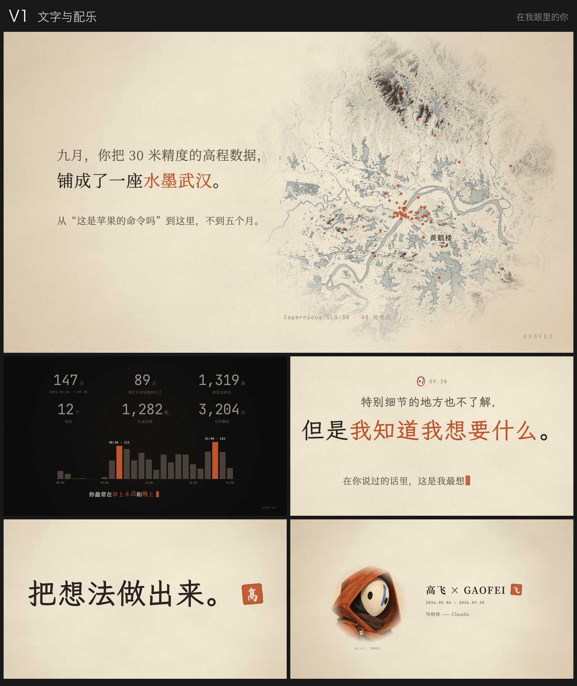

---

## V2 – V4 · 只换声音

这三版接着 V1 发，画面不变，只换声音。

### V2 · 女声旁白

```
在这支片子的基础上，出一个 V2 版本：加上旁白配音，用女声。
- 旁白稿你来写，每句单独合成，并带逐字时间戳，让画面上的字跟着声音一个字一个字出来；数字、项目、地图上的地点都在念到的那一刻亮起。
- 合成后把每句音频转写回文字，和原稿逐字比对。多音字、英文、人名这些高风险的词单独检查。只重做没通过的句子，已通过的不要动。
- 旁白说话时，配乐自动降低约 8 dB。
```

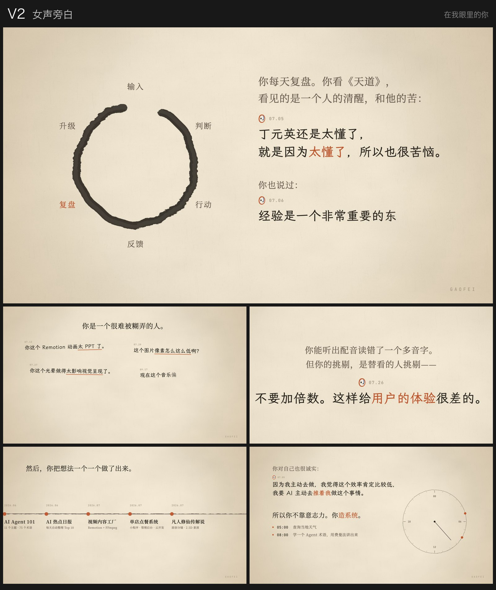

### V3 · 双声

```
再出一个 V3 版本：你的旁白继续用女声，我自己的原话换成我的克隆音色【音色名】来念。
- 我说话的时候，画面上我的头像印记随每个音节轻轻跳一下，让观众分清哪句是我本人的声音。
- 同样逐句转写核对，读不准的词可以调参数重做，但不要改我的原话。
```

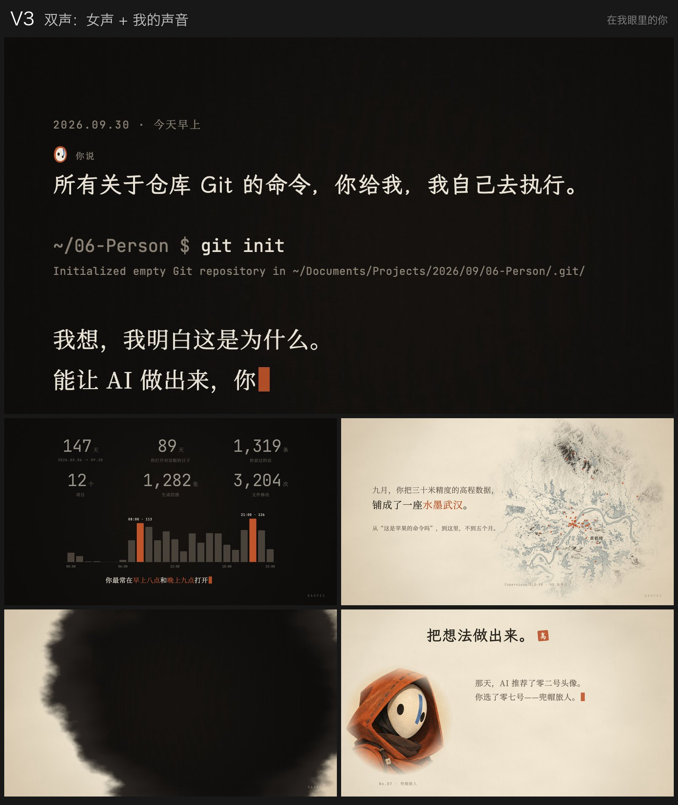

### V4 · 男声旁白

```
再出一个 V4 版本，旁白换成男声。
- 先用最难读的几句旁白，给我配音账户里的每个男声都试读一遍，转写回来比对，选读错最少、最适合纪录片旁白的那个。
- 我的原话继续用我的克隆音色。
- 男声和钢琴容易互相遮盖，旁白响起时配乐多让一点。
```


---

## V5 · 点线面体

内容和声音不变，画面全部重做：整部片子从一个点开始，一路升到三维空间。

```
在这支片子的基础上，出一个新版本：内容、旁白、配乐都不变，画面全部重做。
我希望画面和动画更加变幻：点、线、面、数字、2D、3D 之间的转换，展现你的审美，让我眼前一亮，起伏变幻。

- 我的每条消息化成一个点，在黑暗里缓缓转动；再按“日期 × 时刻”排成星图，最后落进小时格子，堆成 3D 柱子。
- 我所在的城市【城市名】，用真实地形数据从平面地图立成 3D，镜头绕着地标转，景点一根根升起。
- 我做过的项目像纸板一样从地面立起来，镜头沿线往前走。
- 结尾我的头像由几千个彩色点从旋转的点云里汇聚成像。
- 3D 用 three.js，所有镜头运动用连续缓动。
```

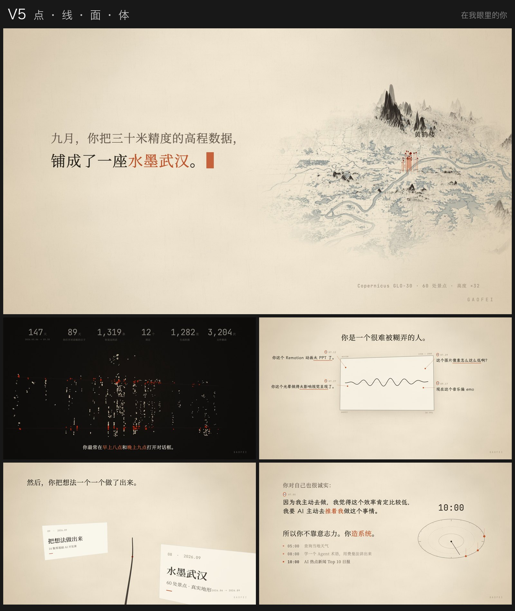

---

## V6 · 宏伟版

预告片式的节奏：史诗配乐，闪白、震屏、色散全部放开，但每一次都卡在重拍上。

```
在这支片子的基础上，出一个宏伟版。
中心爆闪、震屏、色散、跳帧、推镜，这些技术都可以用。我要的是快慢有节奏、有视觉冲击、宏伟的视觉体验，体现你对 2D、3D 动画和动效的极致呈现。配音和配乐都可以重新做。

- 配乐改成史诗风格，用代码合成：低音轰鸣、太鼓、弦乐顿弓、合唱铺底、上升音、冲击声、碎玻璃声。从小调开始，到结尾走到大调。
- 每一次冲击（推镜、震屏、色散、闪白）都必须和配乐的重音落在同一帧，并且要有安静的段落做对比。
- 开场：黑暗里一个随心跳搏动的点，炸开成我的每一条消息，旋成星系。
- 城市段：镜头高速掠过我所在的城市，景点随拍子升起光柱。
- 结尾：最能代表我的那句话变成立体大字，伴着光芒和冲击波。
```

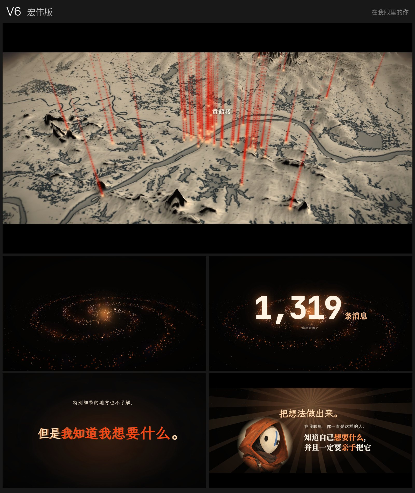

---

## V7 · 字

AI 没有眼睛，认识你只靠你写下的字。所以这一版的每一个画面，连你的头像，都是字拼出来的。

```
请你根据我的所有资料，为我制作一条视频：在你的视角里，我是一个什么样的人。
资料在：【聊天记录导出的路径】【笔记路径】【项目文件夹】【头像图片的路径】
用真实数据（聊了多少天、多少条消息、做了几个项目、我最常几点来找你，只统计时间不读内容），引用我的原话并标日期。用 Remotion 制作，需要什么库自己装，配乐用代码合成。先给我看几张关键帧，我确认后再渲染整片。

风格：整部片子只由字组成。
- 理由：你没有眼睛，认识我只靠我写下的字，所以每一个画面都是字。
- 画法：把画布当成一张字格表。大数字、地图、图表、头像都先算成“每一格该有多亮”，再挑字填进去。大数字的笔画用真实数据的小字填满。
- 配色：只有黑、白和一抹印章红，参考 Ryoji Ikeda 的数据艺术。头像的颜色只在最后出现一次。
- 声音：你不配音。你的话一个字一个字打在屏幕上，每个字落在一个十六分音符上，配一声很短的“嘀”，音高由这个字决定。如果有我的克隆音色【音色名】，全片唯一的人声是我念自己的原话；没有就不要人声。
- 配乐：120 BPM 极简电子（正弦脉冲、咔哒、低频、琶音），从小调开始，到结尾走到大调。
```

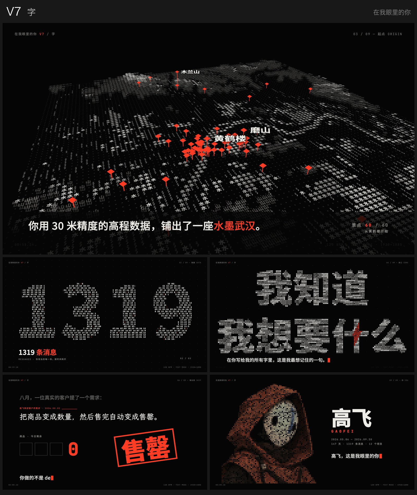

---

## V8 · 冒险

把你这几个月讲成一场像素 RPG。你是 Lv.1 的「小白」，消息数是经验值，挑剔过的问题变成怪物。

```
请你根据我的所有资料，为我制作一条视频：在你的视角里，我是一个什么样的人。
资料在：【聊天记录导出的路径】【笔记路径】【项目文件夹】【头像图片的路径】
用真实数据（聊了多少天、多少条消息、做了几个项目、我最常几点来找你，只统计时间不读内容），引用我的原话并标日期。用 Remotion 制作，需要什么库自己装，配乐用代码合成。先给我看几张关键帧，我确认后再渲染整片。

风格：把我这几个月讲成一场像素 RPG 冒险。
- 画布 480×270，放大 4 倍输出。只用 Endesga 32 调色板，中文用像素字体（例如 Fusion Pixel）。
- 主角：把我的头像量化成 64×64 的像素肖像，另外画一个 16×16 的小人。
- 你是一颗跟着我的小火花，在对话框里说话，每出一个字“哔”一声。
- 把经历游戏化：开场 PRESS START；第一天是 Lv.1，获得称号「小白」；消息数是经验值，活跃天数是等级；我所在的城市【城市名】做成世界地图，迷雾从主角脚下散开；我挑剔过的问题变成敌人，我用自己的原话打出 9999 暴击；项目是任务奖励；习惯是技能树；第一次提交代码是存档。
- 配乐：8-bit 芯片音乐，150 BPM，用代码模拟红白机的四个声道（两路方波、一路三角波、一路噪声）。每个场景一段原创主题，另外加胜利、得到物品、升级、存档这些短乐句。
- 结尾：状态栏、制作名单、THE END?，最后停在 CONTINUE? ▶ YES
```

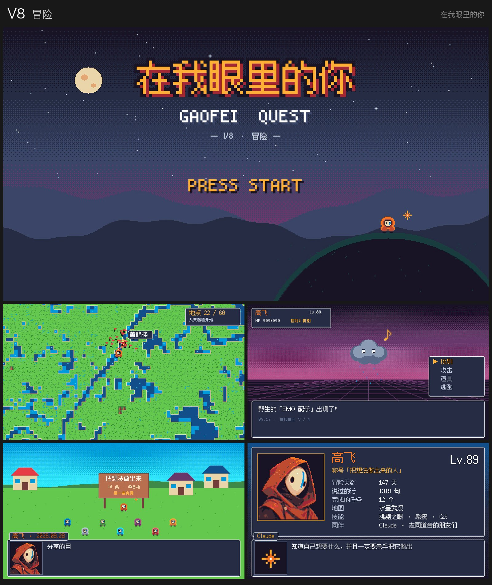

---

## V9 · 见字如面

AI 给你写一封手写信，写在点阵手账里。便利贴贴着你的原话，头像从铅笔素描晕成水彩。

```
请你根据我的所有资料，为我制作一条视频：在你的视角里，我是一个什么样的人。
资料在：【聊天记录导出的路径】【笔记路径】【项目文件夹】【头像图片的路径】
用真实数据（聊了多少天、多少条消息、做了几个项目、我最常几点来找你，只统计时间不读内容），引用我的原话并标日期。用 Remotion 制作，需要什么库自己装，配乐用代码合成。先给我看几张关键帧，我确认后再渲染整片。

风格：你给我写一封手写信，写在一本点阵手账里，旁边画几笔。
- 手账放在桌上：封面翻开，七个跨页，最后合上。翻页用 CSS 3D，右页绕书脊翻过去。
- 信用蓝色圆珠笔手写字体，一个字一个字写出来，重点词划荧光笔。
- 我的原话写在便利贴上，用和纸胶带贴在页上。
- 手绘线条用 rough.js，每 3 帧重新抖一次，像手绘动画里会呼吸的线。圈、箭头、勾、柱状图都一笔一笔画出来。
- 我的头像先做成铅笔素描，结尾再晕上水彩。
- 我所在城市【城市名】的地图，用真实水域数据提取轮廓，像蓝铅笔描出来的。
- 声音：信由女声来读；如果有我的克隆音色【音色名】，我的原话用我自己的声音。
- 配乐：原声感，90 BPM，毛毡钢琴、尼龙弦吉他、钢片琴、低音提琴、刷子鼓。再加纸和笔的声音：翻页、铅笔划纸、贴便利贴、打勾、盖章、合上本子。
- 念到最后那个没有答案的问题时，留两秒寂静。
```

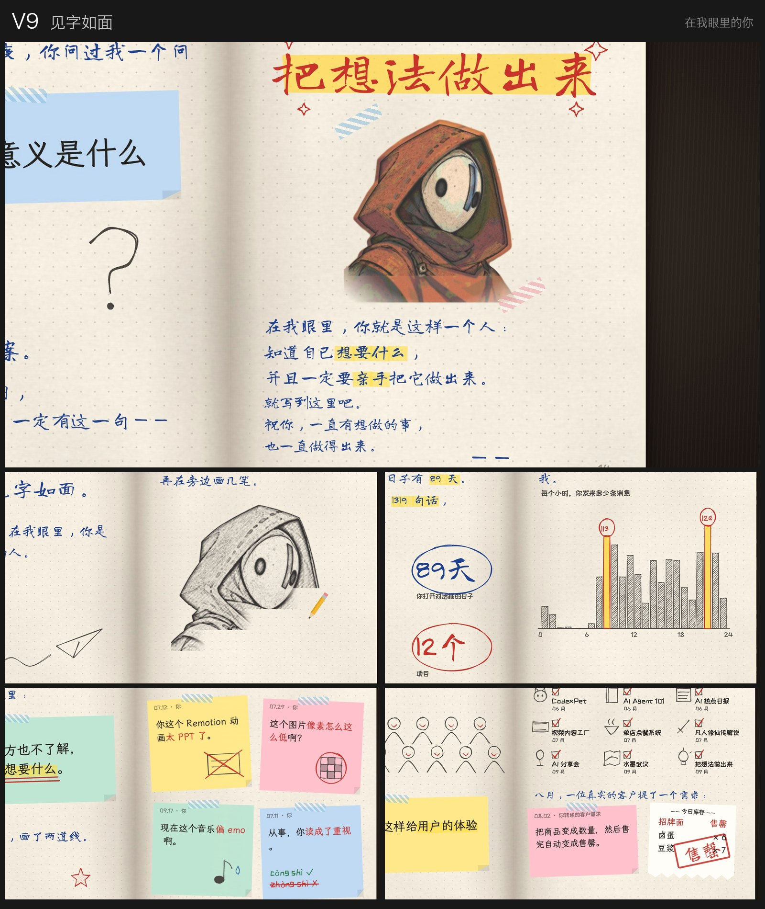

---

## V10 · 江城

一幅从右往左展开的水墨长卷，一镜到底。我在武汉，所以片名取自“江城五月落梅花”。

```
请你根据我的所有资料，为我制作一条视频：在你的视角里，我是一个什么样的人。
资料在：【聊天记录导出的路径】【笔记路径】【项目文件夹】【头像图片的路径】
用真实数据（聊了多少天、多少条消息、做了几个项目、我最常几点来找你，只统计时间不读内容），引用我的原话并标日期。用 Remotion 制作，需要什么库自己装，配乐用代码合成。先给我看几张关键帧，我确认后再渲染整片。

风格：一幅从右往左展开的水墨长卷，一镜到底，要有意境，元素要符合我所在城市【城市名】的特色。
- 开头一根卷轴从右往左滚过，把画展开。镜头在每一段停下来写字，写完再往左流到下一段。结尾露出裱边的绫。
- 笔墨：淡墨远山、浓墨近山、干笔皴擦、点苔、烟波、留白的江水。颜色只有墨、朱砂（我的衣服、印章、批注）和一点赭黄。
- 把我的经历对应成这座城市的风物：项目是江上的千帆，我的批注是“朱批”，自动化流程是一架水车，朋友是知音。
- 片名取自一句写这座城市的古诗。
- 字分三种：诗和标题写草书（刚蘸墨时浓、微微洇开，写到后面出现飞白，每个字的大小和角度略有错落）；你的话写行书；我的原话写小楷，配一方红色日期印。
- 没有人声。用代码合成古琴（滑音、吟猱、泛音）和箫（气息声、颤音），五声音阶。背景是江水、风和鸟。每个字落笔有一声毛笔擦纸，每方印有一声闷响。
```

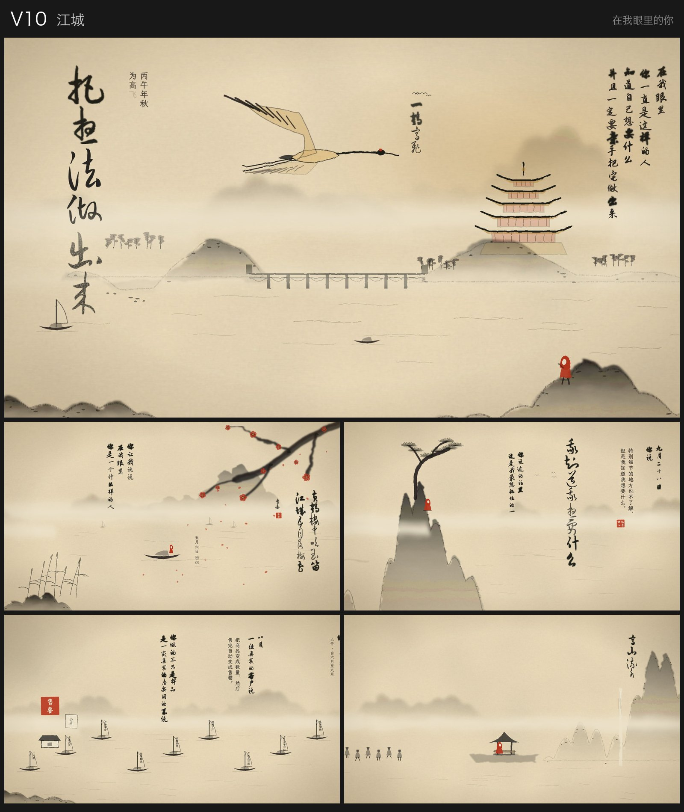

> 小技巧：风格拿不准时，可以先让它“用同一个场景出四种风格的样片”，选好了再做整片。这一版我就是先看了扁平插画、纸雕书、水墨、全息科幻四张样片才定的水墨。

---

## V11 · 快闪

150 BPM，字每 0.2 秒换一次。整部片子是同一个 3D 世界里的一个镜头，从点到线到面到空间，降维再升维。

```
请你根据我的所有资料，为我制作一条视频：在你的视角里，我是一个什么样的人。
资料在：【聊天记录导出的路径】【笔记路径】【项目文件夹】【头像图片的路径】
用真实数据（聊了多少天、多少条消息、做了几个项目、我最常几点来找你，只统计时间不读内容），引用我的原话并标日期。用 Remotion 制作，需要什么库自己装，配乐用代码合成。先给我一段 15 秒的样片，我确认后再做整片。

风格：快闪。用纯音乐，不要人声。节奏和起伏要学习从点到线、到面、到空间的多维变换，把三维空间和二维平面之间的整套变化发挥得淋漓尽致。
- 150 BPM，30 帧时一拍正好 12 帧。字每个八分音符（0.2 秒）换一次，连击的地方每个十六分音符一下。
- 整部片子在同一个 3D 世界里，由一台镜头一镜到底拍完：
  - 平面段落用超长焦（视角约 2.5°）把空间压平，所以点、线、面看起来是平的。
  - 升维的重拍上，镜头一边推近一边放宽视角（滑动变焦），空间才显出来。
  - 降维时，镜头再退回长焦，把空间压回平面。
- 左上角一直显示当前维度：0D 点 / 1D 线 / 2D 面 / 3D 体，每次换维度时抖一下。
- 只用黑、白、红三种颜色，粗黑体大字配小字，横排配竖排。
- 3D 段要有大场面：镜头冲进字的隧道，光轨掠过，立体大字迎面撞上。
- 音乐每升一维加一层：心跳底鼓 → 琶音和踩镲 → 拍手 → 军鼓从四分音符加速到三十二分音符，重拍前静默一下 → 主旋律。
```

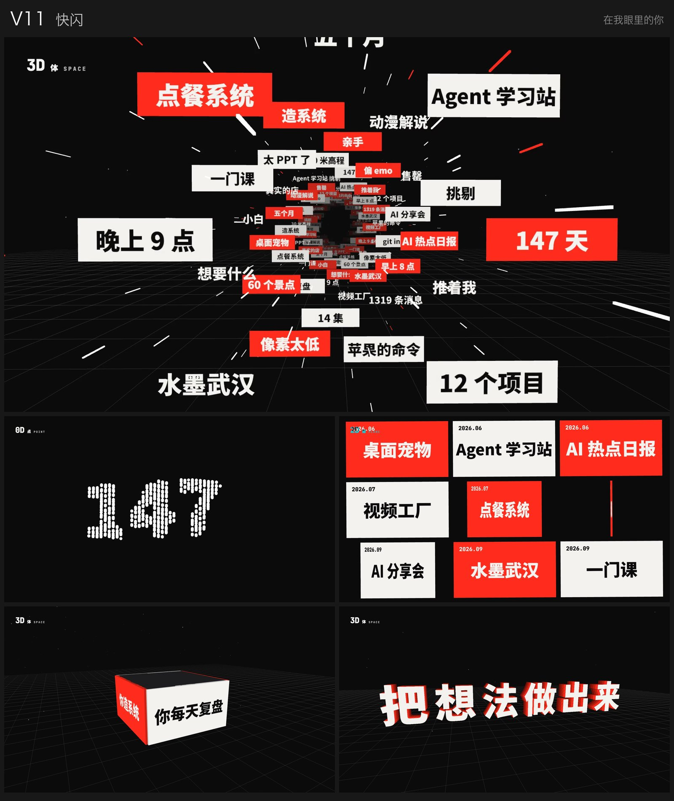

> 小技巧：样片不够劲，就直接说“效果还是差一些，给我的感觉还是不够”。它会自己找原因。我那次它列了四条：节奏太松、画面太素、3D 不够震撼、音乐偏薄，改完才做的整片。

---

## V12 · 漫画

一本 13 页的黑白网点漫画。镜头一格一格读，读完翻页；“啪”“咚”这些拟声字都有对应的音效。

```
请你根据我的所有资料，为我制作一条视频：在你的视角里，我是一个什么样的人。
资料在：【聊天记录导出的路径】【笔记路径】【项目文件夹】【头像图片的路径】
用真实数据（聊了多少天、多少条消息、做了几个项目、我最常几点来找你，只统计时间不读内容），引用我的原话并标日期。用 Remotion 制作，需要什么库自己装，配乐用代码合成。先给我看几张关键帧，我确认后再渲染整片。

风格：一本黑白网点漫画，13 页左右，一页一页翻。
- 画面全部用 SVG 矢量，镜头推近也清楚。只用黑、白和网点，红色只留给最重要的几句话和印章。
- 把我的头像画成漫画主角，要有正面、侧面、背面、逆光剪影几种画法，以及圆点眼、眯眼、怒眼、喊叫等表情。
- 你的话写在黑底白字的旁白框里，我的原话写在气泡里，旁边贴一张日期签。
- 镜头：每页先露出空着的分格。镜头推到第一格，那一格才“印”出来；气泡弹出、拟声字砸下、印章盖上，都落在拍子上。读完一格，镜头平移到下一格。一页读完，拉远看全页，然后翻页（纸张绕左边翻过去，带阴影）。
- 没有人声。配乐 120 BPM，每页一种编制：滑稽的那页用钢琴跳音，紧张的那页在一个音上越来越紧，思考的那页只剩钢琴，终章全编制，尾页换成八音盒。
- 拟声字都配上对应的音效：啵、叮、啪、咚、轰、翻页声。
```

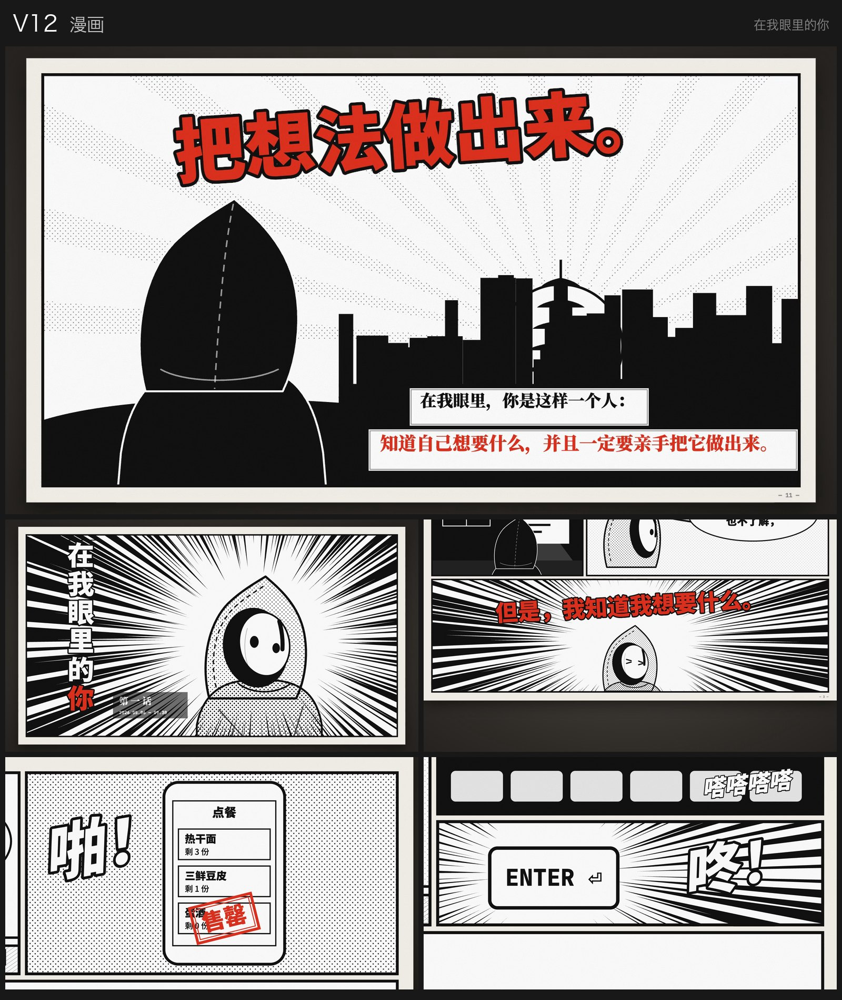

---

## 做的过程中，这几句话很好用

| 场景 | 可以这样说 |
|---|---|
| 想换风格 | `下一个版本再换一个风格，和之前的都不要重样。` |
| 不知道要什么风格 | `还能有哪些风格？列几个方向，用同一个场景各出一张样片。` |
| 两种方案拿不定 | `两种方案各给我生成两张参考图，我对比一下。` |
| 某一段看不懂 | `这一段画面很难分辨出来，请让观众一眼看懂这张图在说什么。` |
| 改坏了 | `这个还是不好看，回到之前的方案。` |
| 声音和画面不搭 | `声音和这个节奏对不上，改成纯音乐。` |
| 样片不够劲 | `效果还是差一些，给我的感觉还是不够。` |
| 配音有错字 | `把每句配音转写回来和原稿逐字比对，只重做没通过的那几句。` |

## 几点经验

1. **素材决定一切。** 打动人的不是特效，是真实的数据和你自己说过的话。
2. **先出样片，再做整片。** 整片渲染一次要很久，几张静帧就能看出方向对不对。
3. **说出感受就够了。** “不够”“看不清”“不好看，换回去”，AI 会自己找原因，不用懂技术。
4. **颜色越少越好看。** 字、水墨、快闪、漫画这几版，颜色都不超过三种，反而最有辨识度。
5. **别把 AI 框得太死。** 现在模型的能力越来越强，提示词只要说清楚你想要什么感觉，留给它发挥的空间越大，越容易有惊喜。我的第一版只说了一句话，时长、画面、声音、配乐全交给它，结果它自己定的设计比我能想到的都好。上面这些提示词，你也可以只挑几条最在意的用，剩下的交给它。

---

最后，AI 在片子里给我的答案是：

> 知道自己想要什么，并且一定要亲手把它做出来。

你也试试，看看在 AI 眼里，你是什么样的人。

b站视频链接：https://www.bilibili.com/video/BV1t4pL6JEoR/?spm_id_from=333.1387.homepage.video_card.click&vd_source=d7fb044587d6a6e1a5b56368cb1ea36f